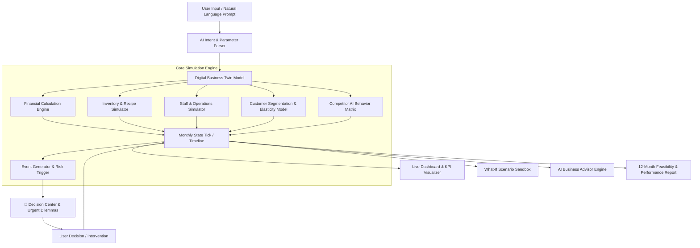

# 🚀 BizPilot AI (مشروعي AI) — Product Requirements & System Architecture

> **Slogan:** *Your Business Before You Build It | جرّب مشروعك قبل أن تستثمر أموالك*  
> **Tagline:** *Build it. Simulate it. Decide it.*

---

## 1. Executive Summary & Core Value Proposition

**BizPilot AI** is an advanced **Digital Business Twin** & **Dynamic Time-Simulation Platform** designed for aspiring entrepreneurs, small business owners, business students, and university incubation programs.

Unlike traditional static feasibility study tools (which output a single static spreadsheet) or generic LLM chatbots (which offer general advice without real data), BizPilot AI combines:
1. **Mathematical Financial & Economic Engine**: Deterministic calculation of Cash Flow, COGS, Break-Even, Runway, Price Elasticity, and Unit Economics.
2. **Dynamic 12-Month Simulation Clock**: Experience your business month-by-month over a full operational year with seasonal shifts and random market turbulence.
3. **Interactive Decision & Event Engine**: Realistic real-world events (supplier price hikes, aggressive competitor discounts, staff absenteeism, viral social spikes).
4. **What-If Scenario Sandbox**: Test assumptions risk-free before spending real capital (e.g., *What happens if I increase latte price by $0.50 and double marketing?*).
5. **Context-Aware AI Business Advisor**: An intelligent advisor with real-time access to the business state, offering explainable diagnosis, bottleneck detection, and 1-click testable suggestions.
6. **Natural Language Business Builder**: Describe your business in plain Arabic/English, and the platform auto-generates the entire financial and operational configuration.
7. **Educational & SaaS Layer**: B2C subscriptions, B2B SME dashboards, and University/Classroom challenge competitions.

---

## 2. High-Level Architecture

---

## 3. Mathematical & Economic Modeling

### 3.1. Revenue & Demand Elasticity
$$\text{Demand}_{m, p} = \text{BaseDemand}_p \times \text{Seasonality}_m \times \left(1 - \epsilon_p \cdot \frac{\Delta P_p}{P_{p, \text{base}}}\right) \times \text{MarketingMultiplier} \times \text{CompetitorIndex} \times \text{StaffCapacityFactor}$$

Where:
- $\epsilon_p$: Price elasticity coefficient of product $p$ (e.g., 1.4 for coffee, 0.8 for specialty items).
- $\text{Seasonality}_m$: Month index factor (e.g., iced drinks peak in Summer, hot beverages in Winter).
- $\text{CompetitorIndex}$: Ratio of own value vs competitor pricing/marketing.
- $\text{StaffCapacityFactor} = \min\left(1.0, \frac{\text{Total Staff Hours} \times \text{Productivity}}{\text{Required Service Hours}}\right)$.

### 3.2. Financial Metrics
1. **Gross Revenue**: $\text{Revenue} = \sum_{p} (\text{SalesQuantity}_p \times \text{Price}_p)$
2. **COGS (Cost of Goods Sold)**: $\text{COGS} = \sum_{p} (\text{SalesQuantity}_p \times \text{UnitCost}_p) + \text{SpoilageWastage}$
3. **Gross Profit**: $\text{Gross Profit} = \text{Revenue} - \text{COGS}$
4. **OPEX (Operating Expenses)**: $\text{OPEX} = \text{Rent} + \text{Salaries} + \text{Utilities} + \text{Marketing} + \text{Taxes/Fees} + \text{Misc}$
5. **Net Profit**: $\text{Net Profit} = \text{Gross Profit} - \text{OPEX}$
6. **Cash Balance**: $\text{Cash}_{m} = \text{Cash}_{m-1} + \text{Net Profit}_m - \Delta\text{InventoryRestock} - \text{Capex}$
7. **Cash Runway**: $\text{Runway} = \frac{\text{Current Cash}}{\text{Average Monthly Burn Rate}}$ (if Net Profit is negative).
8. **Break-Even Revenue**: $\text{BreakEven} = \frac{\text{OPEX}}{1 - (\text{COGS} / \text{Revenue})}$.

---

## 4. Key Platform Modules

| Module | Description | Key Capabilities |
| :--- | :--- | :--- |
| **1. Natural Language Business Builder** | Converts plain text into a configured Digital Twin | Detects capital, category, pricing, city, staff, expenses from natural Arabic/English speech. |
| **2. Interactive Setup Wizard** | Granular setup for business creators | 6-step guided wizard (Basic Info, OPEX, Menu & Pricing, Inventory, Employees, Market). |
| **3. Digital Twin Dashboard** | Live cockpit of the business | Real-time charts, monthly timeline, KPI gauges, cash flow curves, customer sentiment. |
| **4. Event Engine & Decision Center** | Real-world business simulation | 20+ dynamic market events with multi-choice strategic interventions and quantifiable feedback. |
| **5. What-If Comparison Studio** | Risk-free sandbox for strategy testing | Fork business state, adjust parameters (price, marketing, staff), and compare side-by-side. |
| **6. Context-Aware AI Advisor** | AI that diagnoses real simulation data | Identifies why profit fell, warns about inventory depletion, gives testable 1-click recommendations. |
| **7. Inventory & Recipe Simulator** | Raw material depletion tracking | Automatic consumption per cup/dish, low-stock alerts, restock order simulator. |
| **8. Gamified Challenges & University Mode** | Business challenges with scoring | 4 tailored scenarios (Survive Year 1, Price War, Fast Growth, Crisis Recovery) with XP & Badges. |
| **9. 12-Month Executive Report** | Comprehensive feasibility audit | Complete financial statement, decision audit trail, post-mortem evaluation, PDF/Print export. |

---

## 5. UI/UX Design System

- **Color Palette**:
  - Primary Accent: Cyber Emerald / Vibrant Cyan (`#10B981` / `#06B6D4`)
  - Secondary: Electric Purple / Indigo (`#6366F1` / `#8B5CF6`)
  - Warning / Alert: Amber Gold (`#F59E0B`)
  - Danger / Crisis: Coral Red (`#EF4444`)
  - Background: Deep Dark Slate (`#0B0F19`) with Glassmorphism Panels (`rgba(17, 24, 39, 0.75)`) and Light Mode support.
- **Typography**: `Cairo` (Arabic) & `Plus Jakarta Sans` / `Outfit` (Latin & Numbers).
- **Direction**: Full RTL Arabic support with instant LTR English toggle.
- **Sound Effects**: Integrated Web Audio synthesizer for decision clicks, cash gains, alerts, and month transitions.
