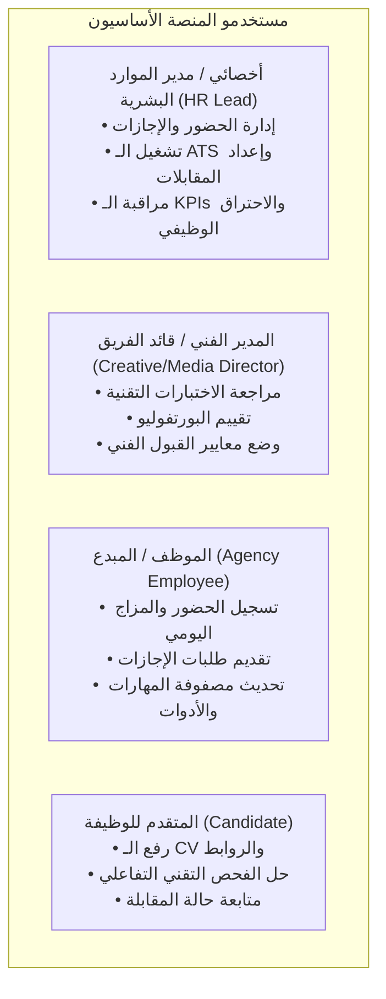
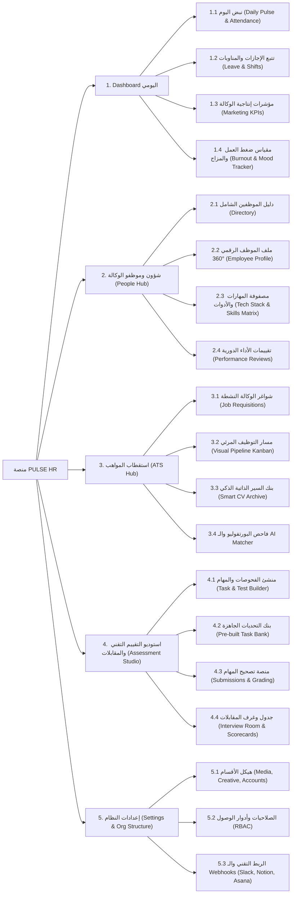
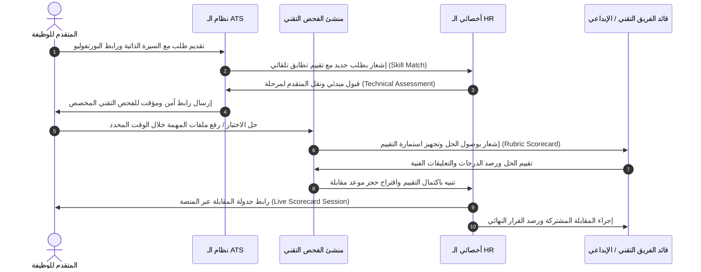
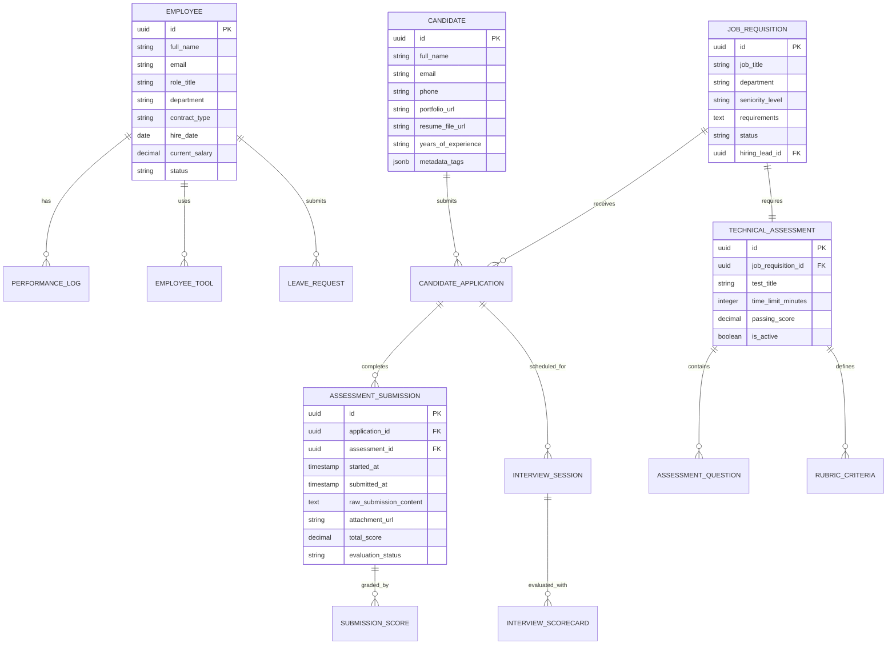
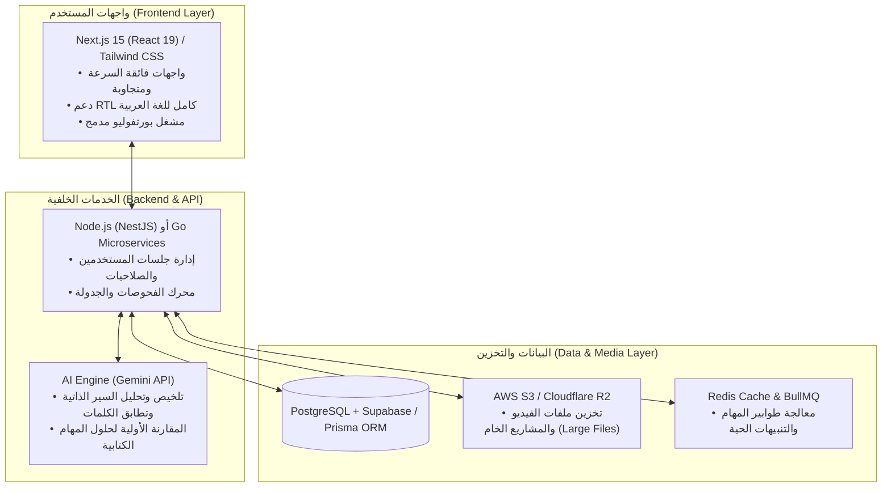

# 🚀 وثيقة المتطلبات البرمجية وهيكلية المنصة (PRD & System Architecture)
## منصة إدارة الموارد البشرية المتخصصة لوكالات التسويق الرقمي والسوشيال ميديا

---

## 1. الرؤية والهوية والاسم المقترح (Vision & Brand Identity)

### 1.1 فلسفة المنصة
بيئة وكالات التسويق الرقمي (Digital Marketing Agencies) تتسم بالسرعة الفائقة، وضغط الحملات (Sprint/Campaign Deadlines)، والاعتماد الكلي على مواهب إبداعية وتقنية (Content Creators, Media Buyers, Designers, Video Editors). تعاني هذه الوكالات من استخدام أنظمة HR تقليدية جامدة لا تفهم متطلبات تقييم ملفات الأعمال (Portfolios)، ولا تقيس المهارات التقنية الحية (ROAS analysis, Video pacing, Scriptwriting)، ولا تراعي سرعة الاحتراق الوظيفي (Burnout).

تم تصميم هذه المنصة لتكون **"Agile Creative-First HR Tech"**، تجمع بين أتمتة العمليات اليومية، والاستقطاب الذكي القائم على اختبارات عملية حقيقية، وربط أداء الموظفين بمؤشرات إنتاجية الحملات وصحة الفريق النفسية.

---

### 1.2 الأسماء المقترحة للمنصة (Brand Name Options)

| الاسم المقترح | الشعار اللفظي (Slogan) | دلالة الاسم وطابعه |
| :--- | :--- | :--- |
| **PULSE HR** *(الخيار الموصى به)* | *The Operating System for Creative Talent* | يعبر عن نبض الفريق وسرعة استجابة الوكالة وتتبع الأداء الحي. |
| **KREATIVE HQ** | *Empowering Creators, Streamlining Growth* | اسم عصري يركز على الطابع الإبداعي لموظفي التسويق مع إدارة احترافية. |
| **TALENT SPRINT** | *Hire Fast, Scale Smart, Retain the Best* | مستوحى من لغة الـ Sprints والسرعة في قطاع الديجيتال. |
| **CAMPAIGN PEOPLE** | *Where Marketing Meets People Ops* | اسم مباشر يربط بين عالم الحملات وإدارة الموارد البشرية. |

---

### 1.3 المستفيدون وشخصيات المستخدمين (User Personas)



---

## 2. هيكلية الموقع وتدفق المستخدم (Sitemap & User Flow)

### 2.1 شجرة الصفحات الشاملة (Detailed Sitemap)



---

### 2.2 تدفق رحلة التوظيف والتقييم التقني (Candidate Journey Flow)



---

## 3. تفصيل الشاشات والواجهات الرئيسية (UI/UX & Wireframe Concepts)

### 3.1 الشاشة الأولى: لوحة التحكم اليومية الذكية (Daily Operations & Tracking Dashboard)

#### أ. الهدف والوظيفة:
مركز التحكم الصباحي واللحظي لأخصائي الـ HR لمراقبة جاهزية فرق العمل، حضورهم، ضغط الحملات الحالية، والمؤشرات الحرجة.

#### ب. التوزيع البصري والهيكلي (ASCII Wireframe Layout):

```
+----------------------------------------------------------------------------------------------------+
|  [PULSE HR]    (Q) بحث سريع...    [+ مهمة سريعة]   [+ شاغر جديد]       (🔔 3)  (HR Manager: سارة)   |
+----------------------------------------------------------------------------------------------------+
| [Sidebar]   | ☀️ صباح الخير سارة! جاهزية الفريق اليوم: 94% | 🗓️ الأحد، 27 سبتمبر 2026                 |
|             +--------------------------------------------------------------------------------------+
| 📊 Dashboard| [ 👥 إجمالي الموظفين: 48 ] [ 🟢 حاضرون: 43 ] [ 🏖️ إجازات: 3 ] [ 💻 عن بُعد: 12 ]    |
| 👥 People   +--------------------------------------------------------------------------------------+
| 💼 ATS      | ⚠️ تنبيهات حرجة: • طلبان إجازة معلقان  • 3 اختبارات تقنية بانتظار تصحيح الـ Media Director  |
| 📝 Tests    +---------------------------------------------------+----------------------------------+
| 📅 Calendar | 📈 مؤشرات إنتاجية الوكالة (Agency Marketing KPIs)   | ⚡ نبض الإبداع والضغط (Team Vibe) |
| ⚙️ Settings | +-----------------------------------------------+ | +------------------------------+ |
|             | • Creative Turnaround Time (TAT): 4.2 hrs (-15%)| | • مؤشر الرضا والضغط: 8.4/10     |
|             | • Reels Delivered This Week: 64 / 70 (91%)     | | • حملات إعلانية نشطة: 18       |
|             | • Live Ad Spend Managed: $142,000              | | • قسم تحت الضغط: Video Editing |
|             | • Revision Rate (نسبة التعديلات): 8.5% (ممتاز)  | | • ساعات العمل الإضافي: 12h     |
|             +-----------------------------------------------+ +------------------------------+ |
|             | 📋 مهام الـ HR اليومية (Quick Actions List)     | 🚀 نشاط الاستقطاب اللحظي (ATS)   |
|             | [ ] مراجعة تقرير حضور Media Buying (10:30 AM)   | • 12 طلب جديد اليوم              |
|             | [ ] جدولة مقابلة Senior Video Editor (01:00 PM)  | • 4 فحوصات مكتملة تنتظر المراجعة|
|             | [ ] تسليم أجهزة لـ Copywriter جديد (03:00 PM)   | • شاغر عاجل: Meta Media Buyer    |
+-------------+---------------------------------------------------+----------------------------------+
```

#### ج. الخصائص التفاعلية ومكونات الـ UI:
1. **Quick Status Filter:** تصفية بضغطة زر لرؤية المتواجدين حسب القسم (Media Buying, Video Editing, Content, Graphic Design, Account Management).
2. **Burnout Early Warning Widget:** خوارزمية ذكية تحتسب تكرار ساعات السهر والتعديلات المرهقة لتنبيه الـ HR قبل حدوث استقالات مفاجئة.
3. **Agency KPI Cards:** بطاقات تفاعلية متصلة بأدوات إدارة المهام لقياس معدل إنجاز البوستات والتعديلات.

---

### 3.2 الشاشة الثانية: واجهة إدارة السير الذاتية ومسار التوظيف (ATS Hub & Pipeline)

#### أ. الهدف والوظيفة:
إدارة دورة حياة المتقدمين للوظائف الإعلانية، مع تركيز فائق على فحص ملفات الأعمال (Behance, Vimeo, Drive, Ad Portfolios) وتصنيف التخصصات الدقيقة.

#### ب. التوزيع البصري والهيكلي (Visual Pipeline Wireframe):

```
+----------------------------------------------------------------------------------------------------+
|  ATS HUB > شاغر: Senior Meta & TikTok Media Buyer (دوام كامل)             [+ إضافة متقدم يدوي]     |
|  🔍 فلاتر: [التخصص: Media Buying ▾] [الخبرة: +3 سنوات ▾] [الأدوات: Meta Ads Manager, GA4 ▾] [ميزانية الحملات: +$50k/m] |
+----------------------------------------------------------------------------------------------------+
|  1. طلبات جديدة (14)   | 2. فحص أولي (6)      | 3. فحص تقني (4)       | 4. مقابلة فنية (2)  | 5. العرض (1) |
+-----------------------+----------------------+-----------------------+---------------------+--------------+
| 🪪 أحمد محمود         | 🪪 ريم خالد          | 🪪 محمد طارق          | 🪪 عمر يوسف         | 🪪 ليلى حسن   |
| ⭐ Score: 92% (AI)    | 🎯 Portfolio: 9/10   | ⏳ الاختبار: جاري الحل | 📅 اليوم 2:00 م     | 💼 تم إرسال  |
| 🛠️ Meta, TikTok Ads   | 🛠️ TikTok, Snapchat  | 📊 المهمة: Campaign   | 👔 مع: Media Head   |   العقد      |
| 💰 Ad Spend: $80k/mo  | 💰 Ad Spend: $40k/mo |    Audit Case Study   | ⭐ Score: 95%       |              |
| [عرض الملف] [تمرير]   | [إرسال الاختبار]     | [عرض النتيجة: 88%]    | [رصد التقييم]       | [قبول نهائي] |
+-----------------------+----------------------+-----------------------+---------------------+--------------+
| 🪪 خالد عبد الله      | 🪪 سارة فهد          | 🪪 ناصر الدوسري       |                     |              |
| ⭐ Score: 81%         | 🎯 Portfolio: 8.5/10 | ⏳ متبقي: 4 ساعات     |                     |              |
| 🛠️ Google Ads, Meta   | 🛠️ Meta, Pinterest   | 📊 المهمة: ROAS Opt   |                     |              |
+-----------------------+----------------------+-----------------------+---------------------+--------------+
```

#### ج. نافذة المتقدم المنبثقة الذكية (Candidate 360 Drawer):
- **معاينة البورتفوليو الحية (Embedded Viewer):** تشغيل فيديوهات الموشن ومشاهدة تصاميم Figma/Behance مباشرة داخل المنصة دون فتح روابط خارجية مشتتة.
- **بطاقة مؤشرات الأداء السابقة (Track Record Highlights):** عرض أعلى ROAS حققه، أكبر ميزانية أدارها شهرياً، أو معدل وصول محتواه (Reach/Views).
- **سجل الملاحظات التشاركي (Collaborative Notes):** إمكانية عمل Mention للـ Creative Director لمناقشة أسلوب المتقدم.

---

### 3.3 الشاشة الثالثة: استوديو بناء الفحص التقني ونظام المقابلات (Assessment Studio & Interview Builder)

#### أ. الهدف والوظيفة:
تمكين الـ HR ورؤساء الأقسام من بناء وتعيين اختبارات ومهام تقنية تحاكي عمل الوكالة الحقيقي، وتصحيحها عبر معايير تقييم موحدة (Rubrics).

#### ب. التوزيع البصري لمنشئ الاختبارات (Test Builder Wireframe):

```
+----------------------------------------------------------------------------------------------------+
|  🛠️ منشئ الاختبارات التقنية > إنشاء فحص مخصص: [Senior Video Editor - Short Form / Reels]           |
+----------------------------------------------------------------------------------------------------+
| [الخطوة 1: البيانات العامة] ── [الخطوة 2: أجزاء الاختبار والمهام] ── [الخطوة 3: معايير التقييم (Rubric)] |
+----------------------------------------------------------------------------------------------------+
| [أدوات السحب والإفلات] | 🧩 هيكل الاختبار الحالي:                                                   |
|                        |                                                                            |
| ➕ سؤال نظري سريع      |  1. سؤال تحليل الـ Hook والريتم (اختيار متعدد وسيناريو) [الوزن: 20%]        |
| ➕ مسألة تحليل بيانات  |     • "إذا انخفض معدل المشاهدة في أول 3 ثوانٍ إلى 18%، ما الإجراء الفوري؟" |
| ➕ مهمة رفع ملفات ومشروع|                                                                            |
| ➕ رابط Google Drive   |  2. المهمة العملية: مونتاج Reel إعلاني من Raw Footages [الوزن: 50%]        |
| ➕ مؤقت زمني محدد      |     • تحميل المواد الأولية: [📥 Download Assets Pack_v1.zip (140MB)]       |
| ➕ إرشادات البراند     |     • المطلوب: تصدير فيديو 9:16 مدته 30 ثانية + تسليم ملف المشروع Premiere/PR |
|                        |     • المؤقت: 24 ساعة من لحظة بدء الاختبار                                  |
|                        |                                                                            |
|                        |  3. سلم التصحيح المعتمد (Grading Rubric) [الوزن: 30%]                     |
|                        |     • سرعة الإيقاع والـ Cut Pacing (10 درجات)                              |
|                        |     • جودة المؤثرات الصوتية و Sound Design (10 درجات)                      |
|                        |     • اختيار الـ Typography والعناوين الجذابة (10 درجات)                   |
+------------------------+----------------------------------------------------------------------------+
| [⚙️ إعدادات الإرسال التلقائي] [إلزام التوقيع على سرية المواد NDA]    [💾 حفظ القالب]  [🚀 تفعيل وإرسال] |
+----------------------------------------------------------------------------------------------------+
```

#### ج. استمارة التقييم الحي أثناء المقابلة (Live Interview Scorecard):
- تقييم فوري بالدرجات (من 1 إلى 5) لكل محور معيار فني وسلوكي.
- نافذة مدمجة لعرض حل المتقدم أثناء التحدث معه ومناقشة تفاصيل الـ Strategy و القرارات الفنية.

---

## 4. قواعد البيانات الحاكمة والعلاقات (Core Data Entities & Architecture)

### 4.1 مخطط الكيانات والعلاقات (Entity Relationship Diagram - ERD)



---

### 4.2 تفصيل الجداول الرئيسية وهيكلية الحقول (Data Schema Dictionary)

| اسم الجدول (Table) | الحقول الأساسية (Core Fields) | الغرض والوصف الوظيفي |
| :--- | :--- | :--- |
| **`employees`** | `id`, `name`, `role`, `department`, `contract_type` (Full-time, Freelance, Retainer), `work_mode` (Remote, Hybrid, Onsite), `status` | سجل الموظفين وبيانات عقودهم وتصنيف دوامهم في الوكالة. |
| **`employee_skills_tools`** | `id`, `employee_id`, `tool_name` (Premiere, Meta Ads, Figma, Notion), `proficiency_level` (Junior, Mid, Senior, Expert), `certified` (Bool) | قاعدة مهارات وأدوات كل موظف لتوزيع الحملات والمشاريع بكفاءة. |
| **`job_requisitions`** | `id`, `title`, `department` (Media, Creative, Strategy), `target_headcount`, `hiring_manager_id`, `status` (Open, Closed, On-Hold) | الشواغر الوظيفية المعتمدة ومواصفات كل دور تسويقي. |
| **`candidates`** | `id`, `name`, `email`, `phone`, `portfolio_links` (Array), `cv_url`, `ai_parsed_skills` (JSON), `current_stage` | سجل المتقدمين الشامل مع الروابط وسجل العمل السابق. |
| **`technical_assessments`**| `id`, `job_id`, `title`, `instructions`, `assets_download_url`, `deadline_hours`, `rubric_schema` (JSONB) | بنك المهام والاختبارات الفنية المرتبطة بالوظائف. |
| **`assessment_submissions`**| `id`, `candidate_id`, `assessment_id`, `submission_links`, `started_at`, `submitted_at`, `reviewer_id`, `score`, `feedback` | إجابات ومهام المتقدمين المرفوعة وتقييمات رؤساء الأقسام. |
| **`interviews`** | `id`, `candidate_id`, `panel_interviewers` (Array), `scheduled_time`, `meeting_link`, `rubric_evaluation` (JSONB), `final_decision` | مواعيد المقابلات التفاعلية واستمارات التقييم الموحدة. |
| **`agency_kpi_logs`** | `id`, `department`, `metric_name` (e.g. Turnaround_Time, Content_Volume), `target_value`, `actual_value`, `logged_date` | سجل مؤشرات أداء فرق التسويق لربطها بقرارات الـ HR. |

---

## 5. نماذج واقعية للفحوصات التقنية المقترحة (Sample Technical Assessments)

> [!IMPORTANT]
> هذه الاختبارات صُممت خصيصاً لتحاكي تحديات وكالات التسويق الحقيقية (Real-world Agency Scenarios) بعيداً عن الأسئلة النظرية التقليدية.

---

### النموذج الأول: فحص تقني لـ Media Buyer (Senior / Mid-Level)

```
📌 المسمى الوظيفي: Performance Media Buyer (Meta & TikTok Ads)
⏱️ مدة الاختبار: ساعتان (Timed Case Study)
🎯 الهدف: قياس قدرة المتقدم على تحليل الأرقام، حل مشكلات الـ ROAS، وتوزيع الميزانيات بذكاء.
```

#### محاور الفحص والمسألة العملية:

#### 1. دراسة حالة واقعية (Troubleshooting Scenario):
> **السيناريو:** متجر إلكتروني لمستحضرات تجميل يعمل بميزانية إعلانية $15,000 شهرياً على Meta Ads. 
> في آخر 14 يوماً، حدثت المشكلات التالية:
> - ارتفع الـ CPA من $12 إلى $28.
> - انخفض الـ ROAS من 3.8x إلى 1.4x.
> - الـ CTR (Link Click-Through) ثابت عند 2.1%، ولكن הـ Conversion Rate انخفض من 4.2% إلى 1.1%.
> - الـ Frequency في حملات التارغتنج ارتفع إلى 5.8 خلال 7 أيام.

**المطلوب من المتقدم:**
1. تشخيص الأسباب الجذرية الثلاثة المحتملة لهذا الهبوط استناداً إلى البيانات أعلاه.
2. وضع خطة عمل تصحيحية فورية من 4 خطوات لإنقاذ الحملة خلال 48 ساعة.
3. كيفية إعادة هيكلة الميزانية بين الـ Prospecting (Top of Funnel) والـ Retargeting (Bottom of Funnel).

#### 2. مهمة الـ Scaling وتوزيع الميزانية:
> تم مضاعفة ميزانية العميل فجأة إلى $50,000 للشهر القادم استعداداً لموسم التخفيضات.
> - وزّع هذه الميزانية على القنوات (Meta Ads, TikTok Ads, Google Search/Shopping).
> - وضّح استراتيجية المزايدة (Bidding Strategy) واختبار الكرياتيف (Creative Fatigue Management).

#### 3. سلم التصحيح والتقييم (Scoring Rubric):

| معيار التقييم | الوزن | التقييم الممتاز (4-5) | التقييم المتوسط (2-3) | التقييم الضعيف (0-1) |
| :--- | :---: | :--- | :--- | :--- |
| **الدقة التحليلية (Analytical Rigor)** | 35% | ربط مباشر بين انخفاض الـ Conv Rate وثبات الـ CTR لتحديد مشكلة الصفحة/العرض + كشف الـ Ad Fatigue. | تشخيص سطحي دون ربط منطقي بين المؤشرات. | مجرد تخمين عشوائي دون استناد للأرقام. |
| **استراتيجية التوسع (Scaling Strategy)** | 35% | خطة واضحة ومقنعة لتوزيع الميزانية عبر مراحل القمع البيعي مع آليات حماية الـ CPA. | خطة تقليدية لزيادة الميزانية عمودياً دون تنويع. | توزيع غير منطقي للميزانية يسبب إهدار الـ Spend. |
| **إدارة المخاطر والسرعة (Action Plan)** | 30% | قرارات حاسمة لإيقاف الإعلانات المستهلكة وإطلاق زوايا تسويقية جديدة سريعاً. | خطوات عامة وغير محددة زمنياً. | خطوات متأخرة أو خاطئة تزيد النزيف المالي. |

---

### النموذج الثاني: فحص تقني لـ Video Editor / Motion Designer (Reels & Social Ads)

```
📌 المسمى الوظيفي: Short-Form Video Editor & Reels Specialist
⏱️ مدة الاختبار: 24 ساعة من تاريخ استلام الملفات
🎯 الهدف: قياس سرعة المونتاج، صناعة الـ Hook الجذاب، اختيار الموسيقى، والتحكم بالريتم البصري.
```

#### محاور الفحص والمهمة العملية:

#### 1. تسليم الحزمة الأولية (Raw Assets Pack):
- يتم تزويد المتقدم برابط سحابي يحتوي على:
  - 6 لقطات فيديو أولية (Raw footage مصورة بكاميرا وهاتف لمنتج قهوة مختصة).
  - ملف صوتي لتعليق صوتي (Voiceover) غير معالج مدته 45 ثانية.
  - هوية البراند البصرية (شعار، خطوط، ألوان كودية).

#### 2. المطلوب من المتقدم:
1. مونتاج فيديو إعلاني رأسي (9:16) مدته لا تتجاوز 25-30 ثانية.
2. ابتكار **Hook بصري ونفسي في أول 3 ثوانٍ** يجبر المشاهد على التوقف (Stop Scroll).
3. إضافة نصوص حركية تفاعلية (Dynamic Typography/Subtitles) متناسقة ومريحة للعين.
4. هندسة صوتية وتناغم كامل مع المؤثرات (Sound Design & Foley effects).
5. تسليم: ملف MP4 نهائي عالي الجودة + ملف المشروع المفتوح (.prproj أو .aep) للتحقق من تنظيم الـ Layers.

#### 3. سلم التصحيح والتقييم (Scoring Rubric):

| معيار التقييم | الوزن | التقييم الممتاز (4-5) | التقييم المتوسط (2-3) | التقييم الضعيف (0-1) |
| :--- | :---: | :--- | :--- | :--- |
| **قوة الـ Hook وأول 3 ثوانٍ** | 30% | خطف بصري وسردي سريع ومبتكر يجذب فئة عشاق القهوة فوراً. | بداية عادية مكررة تفتقر لعنصر المفاجأة. | بداية بطيئة ومملة تتسبب في تخطي الإعلان. |
| **الإيقاع والـ Pacing والتنقلات** | 30% | تناسق مذهل بين القطع السريع والإيقاع الموسيقي دون إرباك للمشاهد. | تنقلات جيدة ولكن الإيقاع غير منتظم في بعض الأجزاء. | إيقاع بطيء أو انتقالات مبتذلة قديمة. |
| **الهندسة الصوتية (Sound Design)** | 25% | طبقات صوتية غنية (مؤثرات صب القهوة، ووش، بوب) ترفع جودة الفيديو. | وجود موسيقى خلفية فقط دون مؤثرات تفاعلية. | تداخل الأصوات أو صوت غير واضح ومزعج. |
| **تنظيم المشروع والملفات المفتوحة** | 15% | طبقات مسماة ومنظمة، مجلدات مرتبة، وحفظ ذكي للأصول. | تنظيم جزئي ومقبول للملفات داخل البرنامج. | فوضى عارمة بالملفات وطبقات مفقودة. |

---

### النموذج الثالث: فحص تقني لـ Content Creator & Copywriter

```
📌 المسمى الوظيفي: Social Media Content Creator & Creative Copywriter
⏱️ مدة الاختبار: 3 ساعات
🎯 الهدف: قياس كتابة المحتوى الفيروسي (Viral Writing)، تنويع نبرة الصوت (Tone of Voice)، وصناعة الأفكار الإعلانية.
```

#### محاور الفحص والمهام الإبداعية:

#### 1. مهمة ابتكار الـ Hooks والإعلانات (Hooks Sprint):
> **العميل:** تطبيق تكنولوجي B2C لإدارة المصاريف الشخصية والميزانية الذكية (Fintech).
> **المطلوب:** كتابة **5 Hooks مختلفة تماماً** لفيديو TikTok/Reels تستهدف زوايا نفسية متنوعة:
> 1. زاوية الألم والخوف (FOMO / Pain Point).
> 2. زاوية الفكاهة والمواقف اليومية (Relatable Humor).
> 3. زاوية الصدمة أو المعلومة المجهولة (Pattern Interrupt / Shocking Fact).
> 4. زاوية المقارنة والتوفير (Smart vs Wasteful).
> 5. زاوية الفضول وسرد القصة (Storytelling Hook).

#### 2. كتابة سيناريو فيديو إعلاني كامل (Full Video Script):
- كتابة سيناريو كامل مدته 30 ثانية لأفضل زاوية من الزوايا السابقة بنظام الجدول المزدوج:
  - **الجانب البصري (Visual Action / On-screen Text):** وصف المشهد والكتابة الظاهرة.
  - **الجانب الصوتي (Audio / Voiceover):** ما يُقال بدقة ومشاعر المتحدث.
  - **الدعوة لاتخاذ إجراء (Strong CTA):** تحفيز التحميل الفوري للتطبيق.

#### 3. مهمة منشور انستغرام تعليمي (Carousel Post Copy):
- كتابة محتوى Carousel تعليمي من 6 شرائح (Slides) لبراند B2B Marketing بعنوان: *"كيف تضاعف مبيعاتك بالإيميل ماركتنج دون حرق ميزانيتك"*.

#### 4. سلم التصحيح والتقييم (Scoring Rubric):

| معيار التقييم | الوزن | التقييم الممتاز (4-5) | التقييم المتوسط (2-3) | التقييم الضعيف (0-1) |
| :--- | :---: | :--- | :--- | :--- |
| **جاذبية الـ Hooks والابتكار** | 35% | أفكار غير مسبوقة، ذكية ومحكمة تخاطب سيكولوجية العميل المستهدف مباشرة. | أفكار مقبولة ولكنها مستهلكة ومنتشرة في الإعلانات. | جمل تقليدية عامة تفتقر لأي عنصر جذب. |
| **تقنية كتابة السيناريو والإخراج** | 35% | رؤية بصرية واضحة، تفاعل قوي بين الصوت والصورة، وCTA مقنع ومحدد. | سيناريو جيد لكنه يركز على الكلام دون توجيه بصري واضح. | كلام إنشائي غير قابل للتصوير أو التنفيذ العملي. |
| **المرونة وتطويع نبرة الصوت (Tone)** | 30% | تمايز هائل ومتقن بين نبرة الـ Fintech الشبابية ونبرة الـ B2B الاحترافية. | تقارب نسبي في النبرة بين المهمتين. | استخدام نبرة واحدة جامدة لا تناسب طبيعة المنصات. |

---

## 6. المتطلبات التقنية والبنية التحتية المقترحة (Tech Stack & Architecture)



---

## 7. الخاتمة وخارطة الطريق للتنفيذ (Implementation Roadmap)

| المرحلة (Phase) | المدة المقدرة | المخرجات الرئيسية |
| :--- | :---: | :--- |
| **المرحلة الأولى: الأساسيات والـ Core HR** | 3 أسابيع | إطلاق نظام الموظفين، الحضور والانصراف، وDashboard العمليات اليومية. |
| **المرحلة الثانية: استقطاب المواهب (ATS)** | 3 أسابيع | مسار التوظيف الـ Kanban، أرشيف السير الذاتية، وعارض البورتفوليو السحابي. |
| **المرحلة الثالثة: استوديو الفحوصات والمقابلات** | 4 أسابيع | منشئ الفحوصات التفاعلي، بنك التحديات، الـ Scorecards، ونظام التصحيح. |
| **المرحلة الرابعة: الربط الذكي ومؤشرات الأداء** | 2 أسابيع | ربط مؤشرات الوكالة (Agency KPIs)، تنبيهات الاحتراق الوظيفي، وتكامل Slack. |
